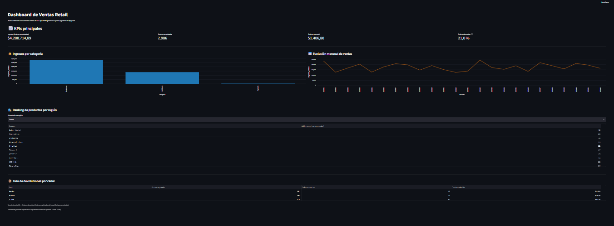

# Lakehouse Retail Analytics

> Pipeline de datos end-to-end con arquitectura Medallion (Bronze / Silver / Gold) para analizar ventas retail, construido con PySpark y Delta Lake, con un dashboard en Streamlit.

[](https://www.python.org/)
[](https://spark.apache.org/)
[](https://delta.io/)
[](https://opensource.org/licenses/MIT)

## Tabla de contenidos

- [¿Qué resuelve este proyecto?](#qué-resuelve-este-proyecto)
- [Arquitectura](#arquitectura)
- [Dataset y calidad de datos](#dataset-y-calidad-de-datos)
- [Stack tecnológico](#stack-tecnológico)
- [Estructura del proyecto](#estructura-del-proyecto)
- [Cómo ejecutarlo](#cómo-ejecutarlo)
- [Resultados](#resultados)
- [Tests](#tests)
- [Licencia](#licencia)

## ¿Qué resuelve este proyecto?

Transforma datos crudos de ventas retail (un CSV con errores reales de calidad) en tablas analíticas listas para consumir, siguiendo la **arquitectura Medallion**.

### Preguntas de negocio que responde

- ¿Cuáles son los productos más vendidos por región?
- ¿Qué categorías generan más ingresos?
- ¿Cuál es la tasa de devoluciones por canal de venta?
- ¿Cómo evolucionan las ventas mes a mes?

## Arquitectura

La arquitectura Medallion organiza los datos en tres capas con calidad creciente:

```text
data/raw  (CSV original, nunca se modifica)
   │
   ▼
BRONZE  →  Ingesta fiel del CSV, guardada como tabla Delta
   │
   ▼
SILVER  →  Limpieza, recuperación de valores corruptos y deduplicación
   │
   ▼
GOLD    →  Agregaciones de negocio para el dashboard
```

| Capa | Qué hace | Script |
| --- | --- | --- |
| **Bronze** | Lee `sales_raw.csv` y lo guarda tal cual en formato Delta | `src/bronze/ingest.py` |
| **Silver** | Limpia y valida los datos (reglas más abajo) | `src/silver/clean.py` |
| **Gold** | Calcula ingresos por categoría, evolución mensual, productos por región y devoluciones por canal | `src/gold/aggregate.py` |

## Dataset y calidad de datos

`data/raw/sales_raw.csv` tiene **5.050 filas y 13 columnas** (`order_id`, `order_date`, `customer_id`, `product_id`, `product_name`, `category`, `region`, `channel`, `quantity`, `unit_price`, `discount`, `total_amount`, `status`), con ventas de 2023-01 a 2024-12.

Problemas detectados y cómo los resuelve la capa Silver:

| Problema en el dato crudo | Tratamiento en Silver |
| --- | --- |
| 50 filas duplicadas exactas | Se eliminan |
| 100 filas con `quantity = -1` (dato corrupto, no una devolución) | La cantidad real se recupera desde `total_amount / (unit_price × (1 − discount))` |
| 103 descuentos nulos (en 63 casos sí hubo descuento) | El descuento se deduce desde `total_amount` en lugar de asumir 0 |
| 1 fila con cantidad negativa y descuento nulo a la vez | Se descarta: no se puede reconstruir |
| 45 `customer_id` y 20 `product_name` nulos | Se reemplazan por `UNKNOWN` |
| Espacios y mayúsculas inconsistentes en texto | `trim` y mayúscula inicial en `region` y `category` |

Resultado: **5.050 filas en Bronze → 4.999 en Silver**. Un control final verifica que `total_amount` coincida con `quantity × unit_price × (1 − discount)` en todas las filas.

> Las devoluciones reales están en la columna `status` (`Completed`, `Returned`, `Cancelled`), no en el signo de la cantidad.

### Reglas de negocio de la capa Gold

- **Ingresos y unidades vendidas** = solo órdenes con `status = Completed` (no suman las canceladas ni las devueltas).
- **Tasa de devoluciones por canal** = órdenes `Returned` / total de órdenes registradas del canal (incluye canceladas).
- **Ticket promedio** = ingresos / órdenes completadas.

## Stack tecnológico

| Componente | Tecnología | Uso |
| --- | --- | --- |
| Lenguaje | Python 3.11+ | Lógica del pipeline |
| Procesamiento | PySpark 3.5.1 | Transformaciones |
| Almacenamiento | Delta Lake 3.2.0 | Formato ACID con versionado |
| Configuración | python-dotenv | Rutas de Java y Hadoop por máquina |
| Testing | pytest | Validar cada capa |
| Visualización | Streamlit + pandas + deltalake | Dashboard de ventas (lee la capa Gold sin necesitar Spark) |
| Control de versiones | Git + GitHub | Historial del código |

## Estructura del proyecto

```text
lakehouse-retail-analytics/
│
├── data/                # Datos en cada capa (bronze/silver/gold se generan al ejecutar)
│   ├── raw/             # CSV original, nunca se modifica
│   ├── bronze/
│   ├── silver/
│   └── gold/
│
├── src/                 # Código del pipeline
│   ├── pipeline.py      # Ejecuta Bronze -> Silver -> Gold
│   ├── utils/           # Sesión de Spark
│   ├── bronze/          # Ingesta
│   ├── silver/          # Limpieza
│   └── gold/            # Agregaciones
│
├── app.py               # Dashboard Streamlit
├── tests/               # Tests con pytest
├── docs/                # Documentación y capturas
│
├── .env.example         # Plantilla de configuración local
├── .gitignore
├── requirements.txt
├── LICENSE
└── README.md
```

## Cómo ejecutarlo

### Requisitos previos

- Python 3.11+ (probado con 3.13)
- Java 17 (necesario para PySpark)
- Git
- **Solo en Windows:** `winutils.exe` y `hadoop.dll` de Hadoop 3.3.x dentro de `C:\hadoop\bin` (por ejemplo desde [cdarlint/winutils](https://github.com/cdarlint/winutils))

### Instalación

```bash
# 1. Clonar el repositorio
git clone https://github.com/ClauRamos/lakehouse-retail-analytics.git
cd lakehouse-retail-analytics

# 2. Crear y activar el entorno virtual
python -m venv venv
venv\Scripts\activate          # Windows
# source venv/bin/activate     # Mac/Linux

# 3. Instalar dependencias
pip install -r requirements.txt
```

### Configuración

Copiá `.env.example` a `.env` y ajustá las rutas a tu máquina:

```text
JAVA_HOME=C:\ruta\a\jdk-17
HADOOP_HOME=C:\hadoop        # solo Windows
```

### Ejecución

Desde la raíz del proyecto, con el entorno virtual activo:

```bash
# Pipeline completo (Bronze -> Silver -> Gold)
python -m src.pipeline

# O capa por capa
python -m src.bronze.ingest
python -m src.silver.clean
python -m src.gold.aggregate

# Dashboard
streamlit run app.py

# Tests
pytest tests/
```

> En Windows, al cerrar Spark pueden aparecer mensajes `ShutdownHookManager ... Failed to delete` o `CORRECTO: el proceso con PID ... ha sido terminado`. Son avisos de limpieza de archivos temporales y no afectan los resultados.

Las carpetas `data/bronze`, `data/silver` y `data/gold` no se versionan: se generan al ejecutar el pipeline, y el dashboard necesita que la capa Gold exista.

## Resultados



### Ver el dashboard

El dashboard se ejecuta en tu máquina con Streamlit. Necesita que exista la capa Gold, así que hay que correr el pipeline una vez:

```bash
python -m src.pipeline
streamlit run app.py
```

Se abre en `http://localhost:8501`.

### KPIs del dataset (órdenes completadas)

| Indicador | Valor |
| --- | --- |
| Ingresos totales | $4.200.714,89 |
| Órdenes completadas | 2.986 |
| Ticket promedio | $1.406,80 |
| Órdenes registradas (todos los estados) | 4.999 |
| Órdenes devueltas | 1.048 (21,0 %) |

## Tests

Próximamente: descripción de los tests implementados.

## Licencia

Este proyecto está bajo la licencia MIT. Ver [LICENSE](LICENSE) para más detalles.
